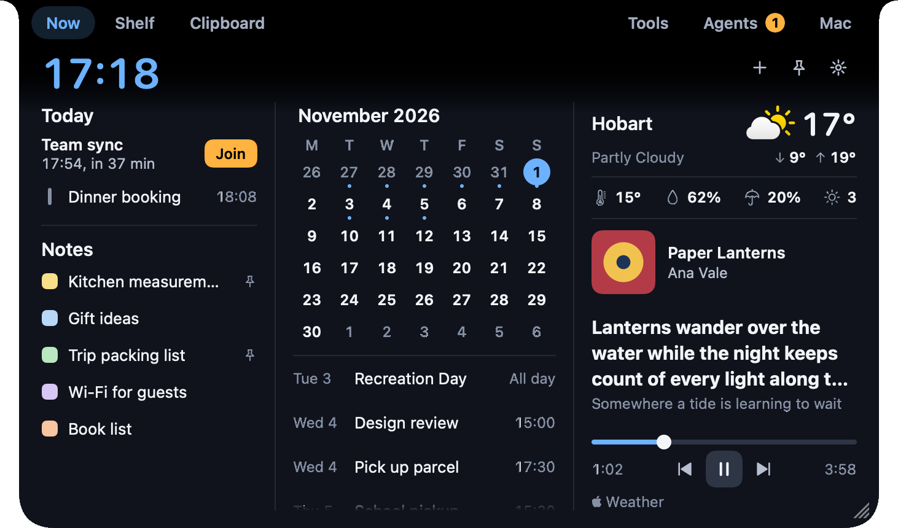
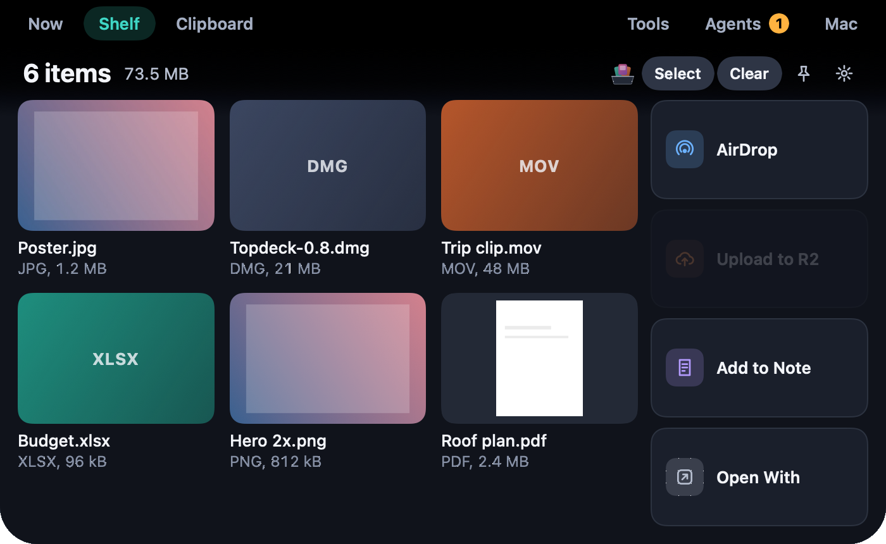
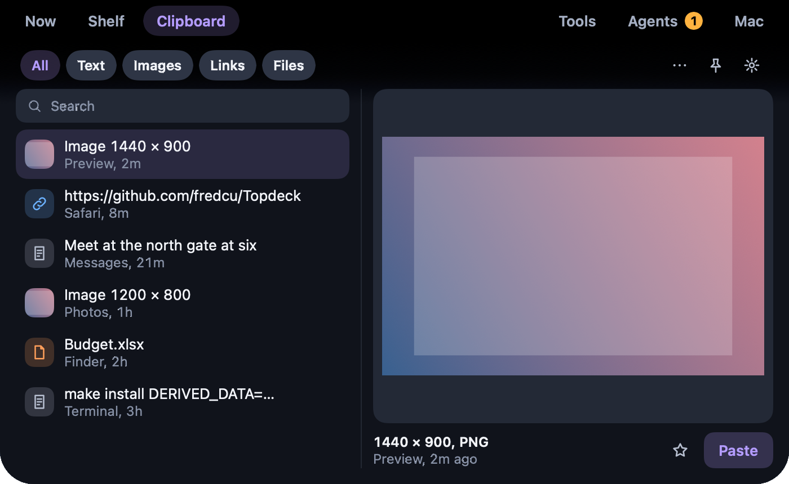
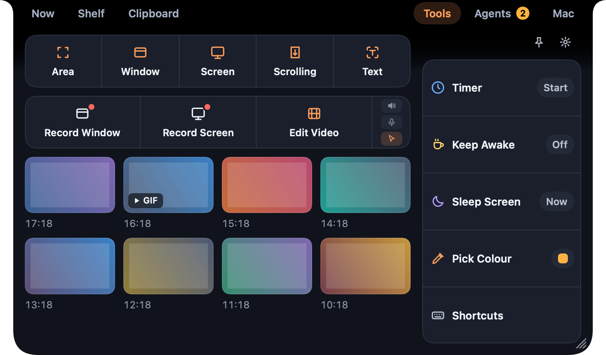
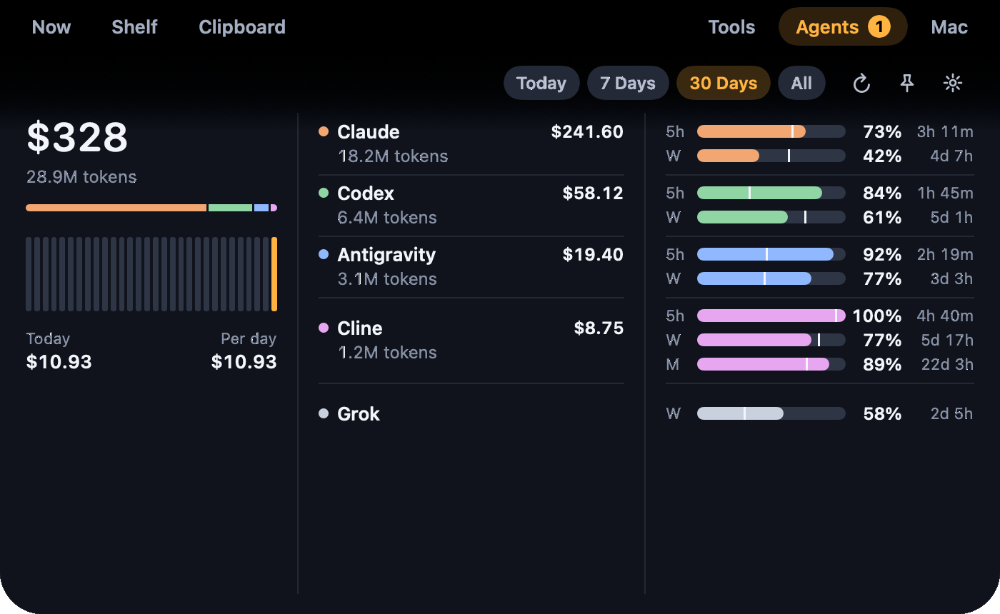
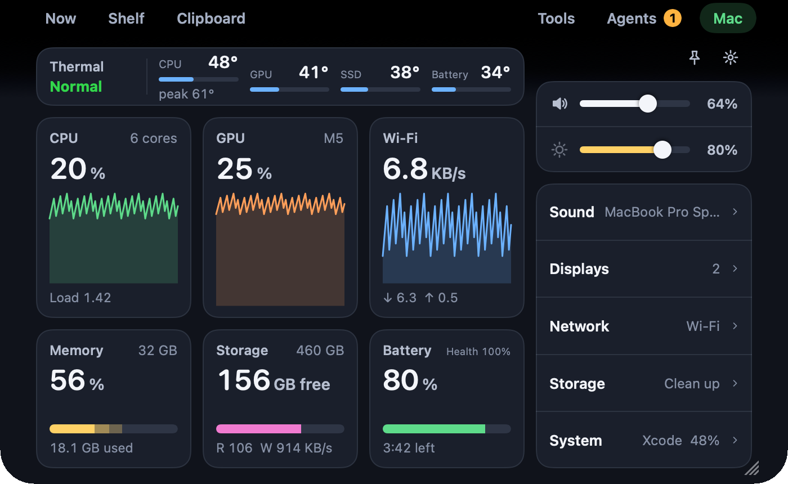
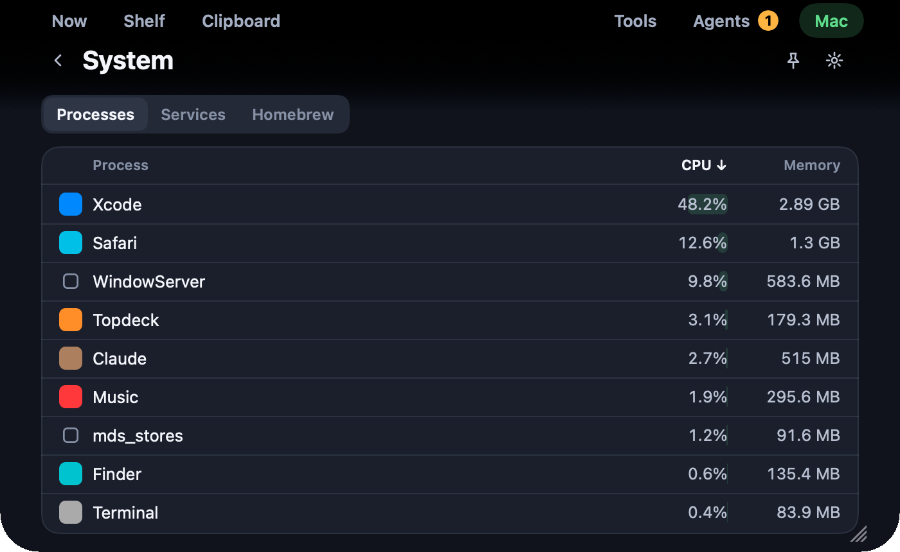

# Topdeck

Your Mac's notch, turned into a deck of everyday tools.

[](LICENSE)


<p align="center">
  
</p>

Topdeck lives in the camera notch. Closed, it shows what is going on (a recording, a waiting agent, the
song, a timer) on either side of the camera. Hover or click and it opens into a deck of six spaces: your
day, a file shelf, the clipboard, capture tools, your AI coding agents and the Mac itself. On a display
without a notch it draws one in the menu bar, or floats as a small pill.

It is native SwiftUI and AppKit, local-first, with no account and no telemetry.

## Spaces

### Now

Today's events with a Join button for the next call, your notes, a month calendar, the weather, and
what's playing with synced lyrics. One field adds an event or a note: type "Dentist tomorrow 3pm" and it
becomes an event; anything else becomes a note, with a colour and a window of its own if you like.

### Shelf



A place to park files while you switch apps. Drop them on the notch from anywhere, then drag them out,
AirDrop them, upload them to your own Cloudflare R2 bucket, add them to a note or open them with any app.

### Clipboard



Clipboard history (off until you turn it on): text, links, images and files, with search, favourites and
a large preview. It pastes into the app in front, as plain text if you like, strips tracking from links
and skips apps you list or items an app marks as secret.

### Tools



- Capture an area, a window, the screen, a scrolling page, or the text on screen.
- Record a window or the screen, with system audio and the microphone as switches, then trim, zoom,
  crop, change speed and add a background in the built-in video editor; export MP4 or GIF.
- A timer and stopwatch, Keep Awake, Sleep Screen, a colour picker, and your Shortcuts.

### Agents



- Answer Claude Code and Codex permission requests, and Claude's questions, from the notch.
- See which sessions are working and which are waiting, and jump to their terminal.
- What each tool cost and how many tokens it used today, this week, this month or ever, and how much of
  its 5-hour, weekly and monthly quota is left, with a mark for where even use would be.

### Mac



The thermal state and the CPU, GPU, SSD and battery temperatures; CPU, GPU, network, memory, storage and
battery at a glance; output volume and external monitor brightness. Sound, Displays, Network, Storage and
System each open a screen of their own.



System lists the busiest processes, and, if you turn on System Admin, your launch agents and Homebrew
packages.

### The closed notch

<p>
  &nbsp;
  &nbsp;
  &nbsp;
  
</p>

Live activities sit beside the camera: a recording, the song, an agent that needs you, a timer, a meeting
about to start, a volume change. Nothing is drawn over the camera itself.

### Also

- **Windows**: shortcuts for halves, thirds, quarters, almost maximize and the next display, drag to snap,
  and saved layouts.
- **Window Switcher**: Option-Tab shows every window with a thumbnail; type to filter (off by default).
- **Command Bar**: open apps, run actions, and search notes and settings from one field.
- **Input Sources**: each app keeps its own keyboard input source.
- **Monitors**: brightness and volume of external monitors over DDC or, when a monitor doesn't answer, by
  dimming the picture.
- **Storage**: clean Xcode's DerivedData, simulators' device support and caches, and see what fills your
  home folder; everything goes to the Trash after a review (off by default).
- **Show in Notch**: scripts and other apps can show a message with a `topdeck://show?title=…` link.

## Requirements

- macOS 14.6 or later. A Mac with a notch is best; other displays get a stand-in.
- To build: Xcode 26 or later (Swift 6.2) and [XcodeGen](https://github.com/yonaskolb/XcodeGen).

## Install

There are no prebuilt releases yet. Build and install from source:

```bash
brew install xcodegen
```

```bash
git clone --recurse-submodules https://github.com/fredcu/Topdeck.git
```

```bash
cd Topdeck && make install
```

`make install` builds a Release copy, puts it in `/Applications` and opens it. Later, `make update` pulls
`main` (when your checkout is clean), rebuilds and relaunches; the app's **Update Topdeck** menu item runs
the same thing.

Builds are signed with your Apple Development certificate when you have one, and ad-hoc otherwise.
macOS ties permissions to the signature, so with an ad-hoc build it asks again after each update.
Weather needs WeatherKit, which needs a provisioning profile for your own App ID; without one, everything
else works and Weather shows as unavailable.

## Permissions

Topdeck asks for a permission only when you turn on the feature that needs it, and declining turns off
only that feature.

| Permission | Asked by |
|---|---|
| Calendars | Now's events |
| Location (approximate) | Weather |
| Screen Recording | Capture tools, recordings and the window switcher's thumbnails |
| Microphone | A recording with the microphone on |
| System audio recording | Per-app volumes in Sound (it never records or stores audio) |
| Accessibility | Windows, the window switcher, replacing the volume display |
| Automation | Music and Spotify controls and lyrics |

## Privacy

Topdeck keeps everything on your Mac. It has no accounts, analytics or telemetry, and it talks to the
network only for the things you turn on: the AI usage providers, uploads to your own R2 bucket, weather
(Apple's WeatherKit), synced lyrics (lrclib.net) and Homebrew actions. The details are in
[PRIVACY.md](PRIVACY.md).

## Private APIs

A few readings have no public API. Each is looked up at run time and fails soft, so a macOS update that
removes one turns that reading off instead of crashing:

- Temperatures: the `IOHIDEventSystemClient` sensors, and the SMC (`AppleSMC`, read-only) for the GPU.
- External monitor brightness and volume over DDC (`IOAVService`).
- Grouping helper processes under their app for per-app volume.

Because of these, Topdeck is not sandboxed and is not on the Mac App Store.

## Development

```bash
make run
```

```bash
make test
```

```bash
make check
```

`make run` builds Debug and relaunches it, `make test` runs the unit, snapshot and performance tests, and
`make check` runs everything CI runs (secrets, lint, changelog, tests, build, licences). Set `SNAPSHOT_DIR`
to write the snapshot tests' pictures, the same ones as in this README:

```bash
SNAPSHOT_DIR=/tmp/topdeck-shots swift test --filter Snapshot
```

The scope, the source and licence rules, and the design for each part are in
[docs/topdeck-plan.md](docs/topdeck-plan.md) and [docs/design-spec.md](docs/design-spec.md).

## Contributing

Issues and pull requests are welcome. Please keep changes focused, add a test for new logic (the logic
lives in AppKit-free code so it can be tested), run `make check`, and add a line to
[CHANGELOG.md](CHANGELOG.md). Every Swift file carries the MIT SPDX header, and any adapted code keeps its
notice and goes in [THIRD_PARTY_NOTICES.md](THIRD_PARTY_NOTICES.md). Code from GPL or non-free projects
can't be accepted.

## Credits

Topdeck started from [ILoveNotch](https://github.com/niyamvora/ILoveNotch) by Niyam Vora (MIT). Other
projects it adapts code from are listed, with their licences, in
[THIRD_PARTY_NOTICES.md](THIRD_PARTY_NOTICES.md).

## License

[MIT](LICENSE)
